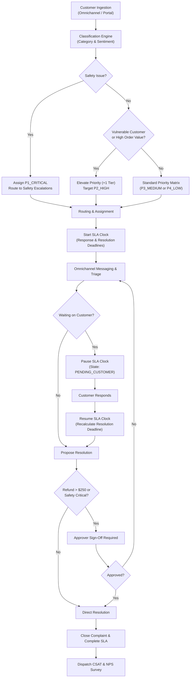

# YottaFlex AI: Enterprise Complaint & SLA Management Platform

[](https://www.python.org/)
[](https://fastapi.tiangolo.com/)
[]()
[]()

An end-to-end operational platform and deterministic synthetic data pipeline built for the **YottaFlex AI Recruitment Drive**. The system classifies customer complaints, assigns owners, dynamically enforces SLA clocks, tracks omnichannel resolutions, captures post-resolution CSAT surveys, and guarantees complete audit traceability.

---

## Table of Contents
1. [Key Capabilities & Highlights](#key-capabilities--highlights)
2. [Primary Actors & Roles](#primary-actors--roles)
3. [Architecture & Workflow State Machine](#architecture--workflow-state-machine)
4. [Synthetic Data Engine (Steps 1–10)](#synthetic-data-engine-steps-110)
5. [Injected Negative Scenarios & Ground Truth](#injected-negative-scenarios--ground-truth)
6. [Quickstart & Execution Guide](#quickstart--execution-guide)
7. [Running Tests & Validation](#running-tests--validation)
8. [Interactive Web Dashboard](#interactive-web-dashboard)
9. [Project Directory Layout](#project-directory-layout)
10. [AI Transparency & Prompt Disclosure](#ai-transparency--prompt-disclosure)

---

## Key Capabilities & Highlights

- **NLP Classification & Severity Analysis**: Keyword heuristics and sentiment polarity scoring (scale: -1.0 to +1.0) with automated detection of product safety hazards.
- **Dynamic Priority Engine (RUL-01 to RUL-08)**: 4 deterministic priority tiers (`P1_CRITICAL`, `P2_HIGH`, `P3_MEDIUM`, `P4_LOW`) dynamically evaluated from safety signals, customer vulnerability status, sentiment intensity, order value, and recurrence.
- **SLA Clock State Machine**: Active timers tracking response and resolution deadlines. Supports paused customer wait states (`PENDING_CUSTOMER`), recalculates deadlines upon resumption, and flags breaches.
- **Approver Governance Workflow**: Enforces mandatory executive sign-off for financial compensation exceeding **$250.00** or safety-critical recalls prior to case closure.
- **Append-Only Audit Store**: All lifecycle transitions, routing actions, and approver interventions are persisted as immutable event records (`EVT-2026-xxxxxxx`). Reopened tickets preserve 100% of prior history.
- **100% Deterministic Reproducibility**: Fixed PRNG seed (`20261022`) generating identical row counts and byte-identical SHA-256 checksums across runs.

---

## Primary Actors & Roles

| Actor Persona | Core System Touchpoints | Responsibilities |
| :--- | :--- | :--- |
| **Business Requester** | Intake APIs, Customer Portal, Survey Dispatcher | Ingests complaints, responds to inquiries, and submits post-resolution CSAT/NPS ratings. |
| **Process Owner** | Policy Configurator, SLA Matrix, Queue Manager | Manages category taxonomies, priority rules, and monitors end-to-end operational throughput. |
| **Approver** | Approval Queue (`/api/v1/complaints?status=RESOLUTION_PENDING`) | Reviews and signs off on high-value compensation (> $250.00) or safety recall remedies. |
| **Operations Analyst** | Metrics Dashboard, Validation Suite, Ground Truth Auditor | Monitors MTTR, SLA compliance %, breach hotspots, and audits data against known anomalies. |
| **System Administrator** | Seed CLI, Event Store Inspector, System Health | Manages database seeding, reproducibility verification, and event store integrity. |

---

## Architecture & Workflow State Machine



---

## Synthetic Data Engine (Steps 1–10)

The synthetic data generation engine satisfies all 10 granular requirements from the problem statement:

- **Step 1 (Data Dictionary)**: Documented in [`docs/DATA_DICTIONARY.md`](docs/DATA_DICTIONARY.md) covering types, constraints, enums, units, and validation rules across all 11 entities.
- **Step 2 (Parent First Generation)**: Generates parent master entities (`customers`, `products`, `categories`, `priority_rules`), then transactional orders, then downstream complaints, messages, assignments, SLA clocks, resolutions, and surveys.
- **Step 3 (Deterministic Nomenclature)**:
  - Customers: `CUS-000001`
  - Orders: `ORD-2026-000001`
  - Complaints: `CMP-2026-000001`
  - Messages: `MSG-CMP-2026-000001-001`
  - SLA Clocks: `SLA-CMP-2026-000001`
  - Resolutions: `RES-CMP-2026-000001`
- **Step 4 (Baseline Volume)**:
  - **5,000 Customers**
  - **8,000 Orders**
  - **2,000 Complaints**
  - **6,000 Messages**
  - Parameterized generator (`--scale 1.0` for full baseline, `--scale 0.1` for dev/testing).
- **Step 5 (Injected Labeled Edge Cases)**: 6 explicit negative scenarios injected (see below).
- **Step 6 (Derived Value Calculation)**: Totals, paused minutes, SLA deadlines, and sentiment polarity computed deterministically from source records.
- **Step 7 (Isolated Ground Truth)**: Stored in `data/ground_truth.json` and `data/ground_truth.csv` without leaking into runtime model feature columns.
- **Step 8 (Automated Validation Suite)**: `scripts/validate_dataset.py` validates PK uniqueness, FK referential integrity, enums, dates, and invariants.
- **Step 9 (Multi-Format Export)**: Exports seed data to `data/csv/`, `data/json/`, `data/sql/seed_data.sql`, and `data/manifest.json`.
- **Step 10 (Seed Reproducibility)**: `scripts/verify_reproducibility.py` regenerates data twice with seed `20261022` and verifies 100% identical SHA-256 checksums and row counts.

---

## Injected Negative Scenarios & Ground Truth

The generator injects 6 explicit labeled negative scenarios to test audit and detection capabilities:

| Code | Defect Injected | Expected Validation Failure | Ground Truth Verification |
| :--- | :--- | :--- | :--- |
| `ERR_ORPHAN_COMPLAINT` | Complaint references non-existent `customer_id` (`CUS-999999`). | Foreign key referential integrity violation. | **100% RECALL (MATCHED)** |
| `ERR_TEMPORAL_INVERSION` | Resolution timestamp (`resolved_at`) occurs 2 days prior to complaint creation. | Chronological order violation (`resolved_at < created_at`). | **100% RECALL (MATCHED)** |
| `ERR_INVALID_SLA_PAUSE` | SLA clock set to `PAUSED` while status remains `IN_INVESTIGATION`. | Invariant violation: Clock can only pause when `PENDING_CUSTOMER`. | **100% RECALL (MATCHED)** |
| `ERR_UNLINKED_RECURRENCE` | Customer filed complaint within 30 days, but repeat flags were stripped. | Recurrence heuristic mismatch: missing `parent_complaint_id`. | **100% RECALL (MATCHED)** |
| `ERR_SAFETY_PRIORITY_MISMATCH`| Product safety hazard assigned `P4_LOW` and routed to General Support. | Priority Matrix rule violation (RUL-01 failure). | **100% RECALL (MATCHED)** |
| `ERR_PREMATURE_SURVEY` | Customer survey submitted 5 hours before formal case resolution. | Lifecycle violation: Surveys permitted only after resolution/closure. | **100% RECALL (MATCHED)** |

---

## Quickstart & Execution Guide

### Prerequisites
- Python 3.10+ (tested on Python 3.11)
- Git

### 1. Install Dependencies
```bash
pip install -r requirements.txt
```

### 2. Generate Synthetic Dataset (Seed: 20261022)
```bash
python scripts/run_generator.py --seed 20261022 --scale 1.0
```

### 3. Run Validation Suite
```bash
python scripts/validate_dataset.py
```

### 4. Verify Seed Reproducibility
```bash
python scripts/verify_reproducibility.py
```

### 5. Launch Application & Interactive Dashboard
```bash
python -m uvicorn src.api.main:app --reload --host 127.0.0.1 --port 8000
```
- **Web Dashboard**: Open [http://127.0.0.1:8000/dashboard](http://127.0.0.1:8000/dashboard) in your browser.
- **Interactive Swagger Docs**: Open [http://127.0.0.1:8000/docs](http://127.0.0.1:8000/docs).

---

## Running Tests & Validation

Run the complete Pytest automated test suite:
```bash
pytest -v
```

Output:
```text
tests/test_api_workflow.py::test_api_health_check PASSED
tests/test_api_workflow.py::test_end_to_end_complaint_lifecycle PASSED
tests/test_priority_rules.py::test_rule_01_safety_critical PASSED
tests/test_priority_rules.py::test_rule_02_vulnerable_customer_negative_sentiment PASSED
tests/test_priority_rules.py::test_rule_03_vulnerable_customer_standard PASSED
tests/test_priority_rules.py::test_rule_04_high_value_repeat_order PASSED
tests/test_priority_rules.py::test_rule_05_severe_frustration_sentiment PASSED
tests/test_priority_rules.py::test_rule_08_standard_low_fallback PASSED
tests/test_sla_engine.py::test_sla_clock_initialization PASSED
tests/test_sla_engine.py::test_sla_response_recording PASSED
tests/test_sla_engine.py::test_sla_pause_and_resume_extension PASSED
tests/test_validation.py::test_validation_suite_executes_cleanly PASSED

======================== 12 passed in 20.49s ========================
```

---

## Interactive Web Dashboard

The embedded dashboard serves all 5 primary actors:
- **Overview & KPIs**: Real-time SLA compliance %, MTTR, CSAT average, and priority/status distribution charts.
- **Complaint Pipeline**: Live searchable and filterable table of tickets. Click **"Inspect"** to view complete 360-degree timeline, conversation messages, and event trail.
- **Approvals Queue**: Dedicated queue for executive approvers to review pending refund requests > $250 or safety incident resolutions with single-click **Approve** and **Reject** buttons.
- **File New Complaint**: Real-time intake form triggering instant text classification, sentiment scoring, and automatic team routing.
- **Integrity & Anomalies**: One-click live audit executing the validation suite against ground-truth labels.
- **Traceability Audit Log**: Append-only event history displaying immutable actions across all actor roles.

---

## Project Directory Layout

```text
yottaflex/
├── .gitignore
├── README.md                           <-- Master setup and architecture guide
├── requirements.txt                    <-- Python dependencies
├── data/
│   ├── csv/                            <-- Generated CSV files (12 tables)
│   ├── json/                           <-- Generated JSON files (12 tables)
│   ├── sql/seed_data.sql               <-- Multi-table SQL seed dump
│   ├── ground_truth.json               <-- Isolated ground truth labels & anomalies
│   ├── ground_truth.csv                <-- CSV format ground truth
│   └── manifest.json                   <-- Checksums, row counts, and metadata
├── docs/
│   ├── DATA_DICTIONARY.md              <-- Step 1 Granular Data Dictionary
│   ├── ARCHITECTURE.md                 <-- System design & state machines
│   └── EVALUATION_METRICS.md           <-- SLA, MTTR, and integrity metrics
├── ai_transparency/
│   └── PROMPT_HISTORY.md               <-- Transparent LLM prompt disclosure log
├── src/
│   ├── generator/
│   │   ├── generator.py                <-- Deterministic generator engine
│   │   ├── rules.py                    <-- Priority & SLA definitions
│   │   └── anomalies.py                <-- Labeled anomaly injectors
│   ├── core/
│   │   ├── classifier.py               <-- NLP text & sentiment classifier
│   │   ├── priority_matrix.py          <-- Priority calculation engine
│   │   ├── sla_engine.py               <-- SLA clock state machine
│   │   ├── routing.py                  <-- Specialized team routing
│   │   └── event_store.py              <-- Append-only audit logger
│   ├── database/
│   │   ├── models.py                   <-- SQLAlchemy ORM entity models
│   │   └── session.py                  <-- Database session & JSON seed loader
│   ├── api/
│   │   ├── main.py                     <-- FastAPI application entrypoint
│   │   ├── schemas.py                  <-- Pydantic request/response schemas
│   │   └── routes/
│   │       ├── complaints.py           <-- Complaint lifecycle endpoints
│   │       └── analytics.py            <-- Metrics & audit endpoints
│   └── static/                         <-- Interactive Web Dashboard
│       ├── index.html
│       ├── styles.css
│       └── app.js
├── scripts/
│   ├── run_generator.py                <-- Data generator CLI
│   ├── validate_dataset.py             <-- Step 8 validation suite
│   └── verify_reproducibility.py       <-- Step 10 reproducibility check
└── tests/
    ├── test_priority_rules.py          <-- Priority matrix unit tests
    ├── test_sla_engine.py              <-- SLA clock unit tests
    ├── test_api_workflow.py            <-- End-to-end API integration tests
    └── test_validation.py              <-- Dataset integrity test
```

---

## AI Transparency & Prompt Disclosure

In compliance with **Item 03 of the YottaFlex AI Candidate Project Submission Guidelines** and **Question 6 of the Candidate FAQ**, the complete prompt history, acceleration disclosure, and record of engineering review are documented in [`ai_transparency/PROMPT_HISTORY.md`](ai_transparency/PROMPT_HISTORY.md).

