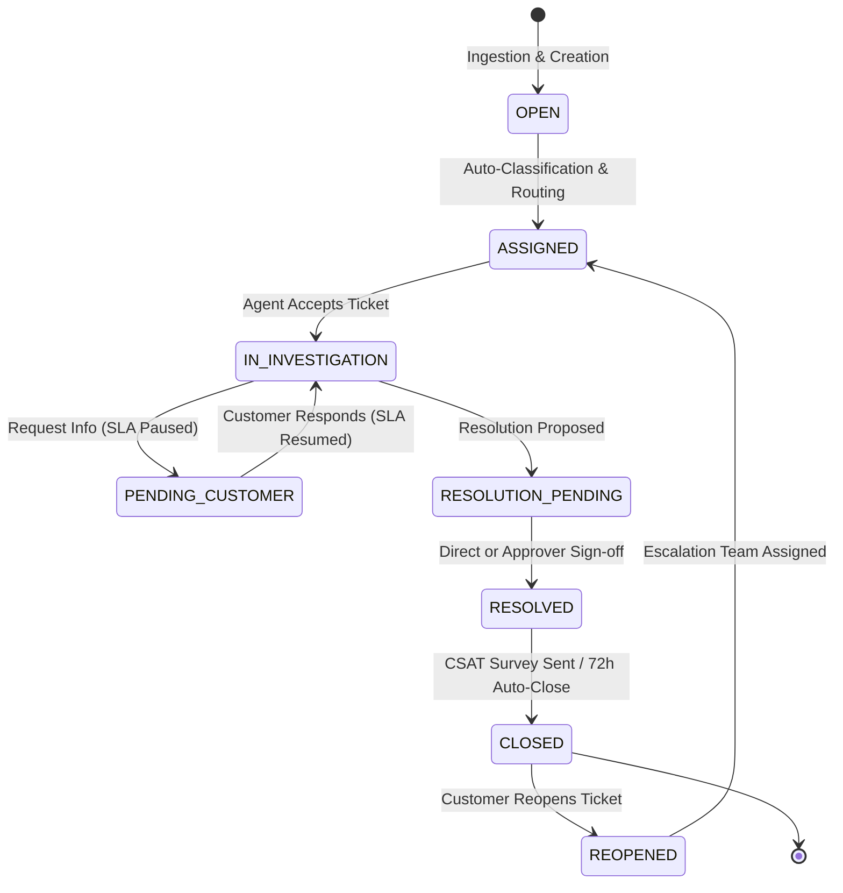

# System Architecture & Technical Specifications

## 1. Primary Actors & Responsibilities

The system serves 5 distinct primary actors:

| Actor Role | Primary Responsibilities | System Touchpoints |
| :--- | :--- | :--- |
| **Business Requester** | Files complaints via omnichannel entrypoints; tracks complaint status; receives notifications and responds to inquiries; completes post-resolution CSAT surveys. | Intake APIs, Customer Portal, Survey Dispatcher. |
| **Process Owner** | Configures category taxonomies, priority rules, SLA target thresholds, and routing matrices; monitors end-to-end operational throughput and SLA compliance. | Policy Configurator, SLA Matrix Engine, Operational Pipeline. |
| **Approver** | Reviews and approves/rejects high-risk or high-financial-value resolutions (refunds > $250.00, safety-critical recalls); enforces governance before financial disbursement. | Approval Queue, Resolution Decision Audit. |
| **Operations Analyst** | Analyzes MTTR, root cause frequencies, agent workload distribution, breach hotspots, and customer sentiment trends; runs anomaly detection and data integrity audits. | Analytics Dashboard, Ground Truth Validation Suite, Metrics APIs. |
| **System Administrator**| Manages role-based access, system health, database migrations, synthetic dataset seeding, reproducibility verification, and event store integrity. | Seed Generator CLI, Health Check, Audit Trail Validator. |

---

## 2. Complaint Lifecycle & Finite State Machine



### Valid Lifecycle Transitions
- `OPEN` -> `ASSIGNED`
- `ASSIGNED` -> `IN_INVESTIGATION`
- `IN_INVESTIGATION` -> `PENDING_CUSTOMER` (Pauses SLA Clock)
- `PENDING_CUSTOMER` -> `IN_INVESTIGATION` (Resumes SLA Clock)
- `IN_INVESTIGATION` -> `RESOLUTION_PENDING` (If approval required)
- `RESOLUTION_PENDING` -> `RESOLVED` (Approver sign-off granted)
- `RESOLUTION_PENDING` -> `IN_INVESTIGATION` (Approver rejected remedy)
- `IN_INVESTIGATION` -> `RESOLVED` (Direct resolution if approval not required)
- `RESOLVED` -> `CLOSED` (Post-resolution survey triggered)
- `CLOSED` -> `REOPENED` (Retains prior history; new event chain initiated)

---

## 3. Dynamic Priority & Routing Rules Engine

Priority is computed deterministically using a multi-factor score:

$$
\text{Priority Score} = w_{\text{safety}} + w_{\text{vulnerability}} + w_{\text{value}} + w_{\text{sentiment}} + w_{\text{recurrence}}
$$

### Rule Matrix

| Rule ID | Condition Expression | Resulting Priority | Target Response | Target Resolution |
| :--- | :--- | :--- | :--- | :--- |
| **RUL-01** | `is_safety_issue == True OR category == 'Product Safety'` | **P1_CRITICAL** | 1 Hour | 4 Hours |
| **RUL-02** | `is_vulnerable == True AND sentiment_score < -0.40` | **P1_CRITICAL** | 1 Hour | 4 Hours |
| **RUL-03** | `is_vulnerable == True` (Standard) | **P2_HIGH** (Tier +1) | 4 Hours | 24 Hours |
| **RUL-04** | `order_amount >= 1000.00 AND is_repeat == True` | **P2_HIGH** | 4 Hours | 24 Hours |
| **RUL-05** | `sentiment_score <= -0.70` (Severe Frustration) | **P2_HIGH** | 4 Hours | 24 Hours |
| **RUL-06** | `order_amount >= 500.00 OR is_repeat == True` | **P3_MEDIUM** | 12 Hours | 48 Hours |
| **RUL-07** | `severity == 'HIGH'` (Standard High) | **P2_HIGH** | 4 Hours | 24 Hours |
| **RUL-08** | *Default fallback* | **P4_LOW** | 24 Hours | 96 Hours |

---

## 4. SLA Clock Mechanics & Business Hours

### SLA Target Specifications
- **P1_CRITICAL**: First Response <= 1h | Resolution <= 4h | Monitored 24/7/365
- **P2_HIGH**: First Response <= 4h | Resolution <= 24h | Standard Business Hours
- **P3_MEDIUM**: First Response <= 12h | Resolution <= 48h | Standard Business Hours
- **P4_LOW**: First Response <= 24h | Resolution <= 96h | Standard Business Hours

### SLA Clock States
1. **RUNNING**: Active calculation against target timestamp.
2. **PAUSED**: When complaint status changes to `PENDING_CUSTOMER`. Paused start timestamp recorded; deadline is extended dynamically by paused duration.
3. **RESUMED**: When customer responds. Paused duration is committed to `paused_duration_minutes`.
4. **BREACHED**: Wall clock surpasses target timestamp while status is not resolved/closed.
5. **COMPLETED**: Resolution timestamp recorded before or after target deadline.

---

## 5. Explicit Anomaly Injection & Ground Truth Isolation

To satisfy Step 5 and Step 7, 6 distinct edge cases are injected into the baseline data. Each anomaly is explicitly tagged with an `anomaly_code` in the separate `ground_truth.json` / `ground_truth.csv` file, completely isolated from input feature columns:

| Anomaly Code | Name | Injected Defect | Expected Validation Failure |
| :--- | :--- | :--- | :--- |
| `ERR_ORPHAN_COMPLAINT` | Complaint without customer | `customer_id` references non-existent ID (e.g. `CUS-999999`). | Foreign key referential integrity violation. |
| `ERR_TEMPORAL_INVERSION` | Resolution before complaint | `resolved_at` is timestamped prior to `complaint.created_at`. | Chronological order violation (`resolved_at < created_at`). |
| `ERR_INVALID_SLA_PAUSE` | SLA clock pauses incorrectly | Clock enters `PAUSED` state while complaint remains `IN_INVESTIGATION` or `ASSIGNED`. | Invalid clock state transition without `PENDING_CUSTOMER`. |
| `ERR_UNLINKED_RECURRENCE`| Repeat issue not linked | Customer filed matching category complaint within 7 days, but `is_repeat_complaint=False` and `parent_complaint_id=None`. | Recurrence detection heuristic mismatch. |
| `ERR_SAFETY_PRIORITY_MISMATCH`| Safety in low-priority queue| `is_safety_issue=True`, but assigned `P4_LOW` priority and routed to General Support. | Priority Matrix rule violation (RUL-01 failure). |
| `ERR_PREMATURE_SURVEY` | Survey before closure | `survey.submitted_at` occurs before `complaint.closed_at` or while status is `OPEN`. | Lifecycle milestone violation. |

---

## 6. Full Traceability & Audit Store

Every state transition generates an immutable record in `complaint_events`:
```json
{
  "event_id": "EVT-2026-0000142",
  "complaint_id": "CMP-2026-000412",
  "event_type": "RESOLUTION_APPROVED",
  "actor_role": "APPROVER",
  "actor_id": "APP-0042",
  "event_payload": {
    "compensation_amount": 350.00,
    "resolution_type": "FULL_REFUND",
    "previous_status": "RESOLUTION_PENDING",
    "new_status": "RESOLVED"
  },
  "created_at": "2026-10-24T14:22:10Z"
}
```
History is never overwritten; all reports, timelines, and audit trails reconstruct entity state by folding events.
